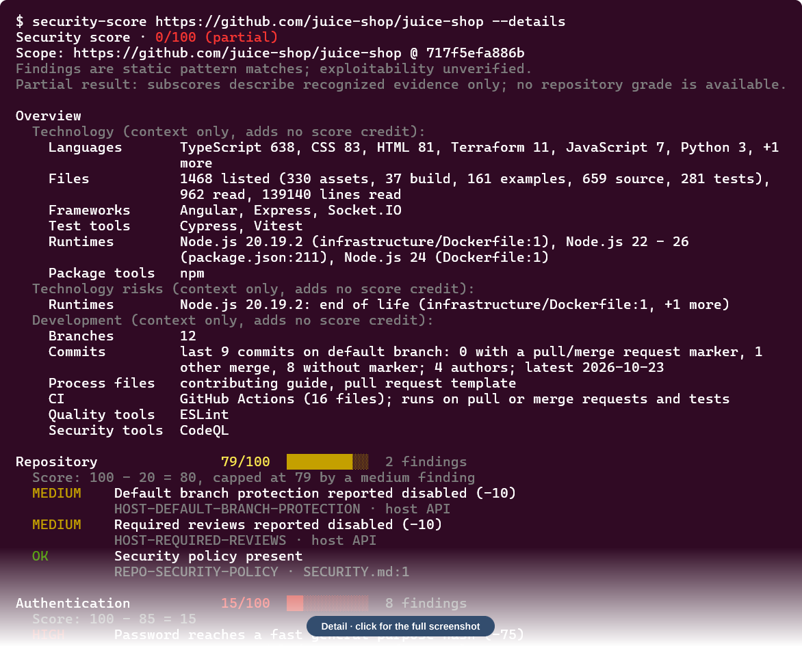

# appsec-tools

[](LICENSE)

Command-line tools that go with
[appsec-analyzer](https://github.com/appsec-foundry/appsec-analyzer). Each tool
lives in its own directory, is installed on its own, and runs without
appsec-analyzer or an LLM. The core application is developed in the
appsec-analyzer repository.

| Tool | Reads | Produces |
| --- | --- | --- |
| [Security Score](#security-score) | A GitHub or GitLab URL, a local directory, or a single change | Security subscores from 0 to 100, including AI & agents, and an overall verdict, or the security relevance of the change |
| [Requirement Harvester](#requirement-harvester) | Websites and wikis named in a configuration file | A catalog of security requirements in OSCAL YAML |

All tools need Python 3.12 or newer, `pipx`, and Git. Installation uses
HTTPS; public repositories need no GitHub account or SSH key.

## Security Score

Scans a repository and reports a score from 0 to 100 with a plain-language
rating. `--details` adds five subscores, colored bars and grouped findings. It also rates how security-relevant a single change is. The checks are
fixed rules, and the scanned code is never run.

```sh
pipx install "git+https://github.com/appsec-foundry/appsec-tools.git#subdirectory=security-score"
```

Pass a GitHub URL to scan a repository without cloning it. Public repositories
need no token:

```console
$ security-score https://github.com/juice-shop/juice-shop
0/100 (Very bad)
```

[Juice Shop](https://github.com/juice-shop/juice-shop) is insecure on purpose,
so the low subscores are expected. Areas without sufficient evidence remain
Not assessed; incomplete processing is reported separately.

`--details` adds the tool version, repository overview, colored bars, grouped
findings and calculation for each area. `--legacy-score` selects the previous A–F output; `--score` remains an alias
for the default assessment. The screenshot shows `--legacy-score --details`:

<a href="security-score/docs/details-juice-shop.png">
  
</a>

A URL scan also checks settings only the host knows, such as branch protection
and required reviews; those are the two findings under Repository. Only files
the tool can check are downloaded: the Juice Shop scan fetched 962 files in about
14 seconds. GitLab.com and self-managed GitLab URLs work the same way. For a
private repository, pass the name of the environment variable that holds a
read-only token:

```sh
security-score https://github.com/example/private-project --token-env GITHUB_READ_TOKEN
security-score https://gitlab.company.example/team/project --token-env GITLAB_READ_TOKEN
```

Local directories and single changes work too:

```console
$ security-score /path/to/repository --legacy-score
59/100 (E)
$ security-score /path/to/repository --commit HEAD
Security relevance: high · 0 introduced, 0 worsened findings
```

[Installation, options and how the score works](security-score/README.md)

## Requirement Harvester

Reads security requirements from websites and wikis and writes them to an
[OSCAL](https://pages.nist.gov/OSCAL/) catalog in YAML. A configuration file
says which pages to read and how requirements are recognized on them.

```sh
git clone https://github.com/appsec-foundry/appsec-tools.git
cd appsec-tools/requirement-harvester
pipx install .
```

```console
$ requirement-harvester run --config examples/tss-web.yaml
{"status": "complete", "requirements": 116, "catalogs": 1, "dry-run": false}
```

appsec-analyzer cannot import the OSCAL catalog directly yet.

[Configuration, inputs and outputs](requirement-harvester/README.md)
