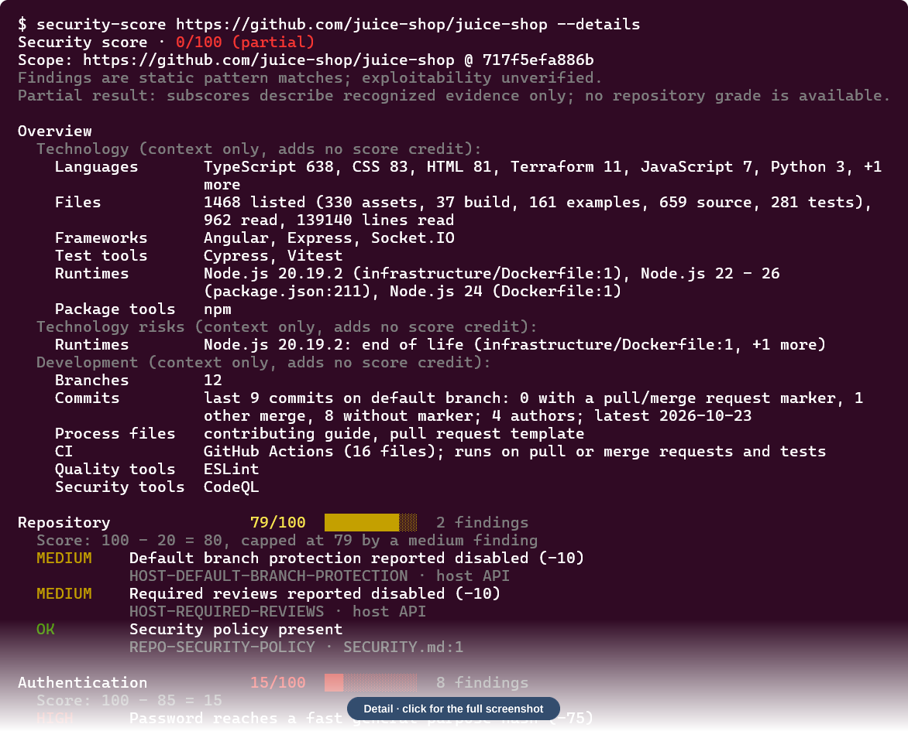

# Security Score

Reports five security subscores with `--score`: Architecture & isolation,
Identity & access, Data & processing, Dependencies & supply chain, and Deployment
& operations. Each supported score has a plain-language rating and separate
evidence coverage; an overall verdict explains the decisive weakness without
averaging the numbers. Insufficient evidence leaves an area Not assessed.

It reads selected source and configuration with fixed rules, without model calls
or executing the target. The [scoring reference](references/subscores.md) explains
the criteria, worked calculations and architecture limits. Direct calls without
`--score` retain the legacy 0–100/A–F output; changes retain security relevance.

## Quick start

Requires Python 3.10+, `pipx`, and Git. Installation uses HTTPS; public
repositories need no GitHub account or SSH key.

```sh
pipx install "git+https://github.com/appsec-foundry/appsec-tools.git#subdirectory=security-score"
```

```console
$ security-score /path/to/repository --score
Architecture & isolation               — · Not assessed · limited evidence
Identity & access                      — · Not assessed · limited evidence
Data & processing                      — · Not assessed · limited evidence
Dependencies & supply chain            — · Not assessed · limited evidence
Deployment & operations           59/100 · Bad · limited evidence

Overall: Bad
Reason: Deployment & operations: Python certificate verification disabled

$ security-score /path/to/repository --commit HEAD
Security relevance: high · 0 introduced, 0 worsened findings
```

The repository example contains one explicitly disabled certificate check.
Unavailable evidence remains separate from that established weakness.

`--details` adds the repository overview, evidence, gaps and calculation for each
area. The following screenshot shows the legacy detail mode without `--score`.

<a href="docs/details-juice-shop.png">
  
</a>

## Five-subscore assessment

```sh
security-score /path/to/repository --score
security-score /path/to/repository --score --details
security-score /path/to/repository --score --json
```

For a fixture with one explicitly disabled certificate check, Deployment is
`59/100 · Bad · limited evidence`; other areas without evidence stay Not assessed.
The overall verdict is Bad and names certificate validation as the reason.

`--details` explains deductions, supported controls and open questions, and shows
recognized SSO server URLs (including realm paths) and artifact repositories such
as Nexus or Artifactory. Endpoint profiles distinguish configuration from lockfile
observations and omit credentials and query tokens. These names earn no points.

Cloud/IaC details identify declared Terraform providers, regions, resource roles,
selected security properties and state backends. Python/Node profiles distinguish
version/lock consistency, artifact hashes and applicable locked-install declarations.
Unsupported lock formats and unresolved build workflows remain gaps; see the
[profile coverage](references/subscores.md#cloud-and-supply-chain-profiles).

The scanner can establish some declared isolation and privilege weaknesses, but
cannot complete architecture trust-boundary or resource-authorization reviews.
Those missing reviews prevent favorable Architecture/Identity and overall ratings;
they do not hide an established serious weakness. See [criteria and examples](references/subscores.md).

## Usage

```sh
security-score                                           # current directory
security-score /path/to/repository --details             # overview and findings per topic
security-score /path/to/repository --json                # all findings, also --yaml
security-score /path/to/repository --quiet               # only the number
security-score /path/to/repository --checks tls,headers  # selected checks
security-score /path/to/repository --staged              # relevance of staged changes
security-score /path/to/repository --base main --head HEAD
security-score https://github.com/example/private-project --token-env GITHUB_READ_TOKEN
```

URLs work for GitHub.com, GitLab.com and self-managed GitLab instances. Other
HTTPS hosts are treated as GitLab; the host and optional port come from the
repository URL. Public repositories need no token. To select a token explicitly,
put it in an environment variable and pass its name:

```sh
security-score https://gitlab.company.example/team/project --token-env GITLAB_READ_TOKEN --details
```

Repository URLs work with or without a trailing `.git`; both select the same
project through the host API.

If `GIT_TOKEN` is already exported, you can omit `--token-env` and the
configuration file. The tool starts anonymously and retries once with
`GIT_TOKEN` on HTTP 401, 403 or 404, only at the selected HTTPS API origin:

```sh
security-score https://gitlab.company.example/team/project --details
```

To assign different tokens to specific hosts, create
`~/.config/security-score/token-hosts.json`
(or `$XDG_CONFIG_HOME/security-score/token-hosts.json`):

```json
{
  "https://gitlab.company.example": "GIT_TOKEN",
  "https://api.github.com": "GITHUB_TOKEN"
}
```

This file contains environment variable names, not token values. Set the named
variables before running the tool. You can then omit `--token-env`:

```sh
security-score https://gitlab.company.example/team/project --details
```

Automatic reads start anonymously. On HTTP 401, 403 or 404, the tool retries the
request once with the token assigned to that exact HTTPS origin, or `GIT_TOKEN`
when no mapping matches. An origin includes its port; configure
`https://gitlab.company.example:8443` separately when needed. `--token-env NAME`
overrides both and uses that token from the first request. A missing or invalid
explicitly selected or mapped variable is an error; it does not fall back to
`GIT_TOKEN`. Without a matching mapping or `GIT_TOKEN`, access stays anonymous.

The GitLab token needs `read_api` and access to the project. The tool reads files
and host settings through the API without cloning. Internal GitLab addresses,
including shared address space `100.64.0.0/10`, and custom HTTPS ports are
supported; loopback, link-local and cloud metadata addresses remain
blocked. For an internal certificate authority, use your system trust store or
set `SSL_CERT_FILE` to its CA bundle. SSH URLs and other Git providers need a
local checkout. Self-managed GitLab URLs use the internal engine.

HTTP proxies are supported for HTTPS repository scans:

```sh
export HTTP_PROXY=http://proxy.company.example:3128
security-score https://gitlab.company.example/team/project --token-env GIT_TOKEN --details
```

The tool checks `HTTPS_PROXY`, then `ALL_PROXY`, then `HTTP_PROXY`; lowercase
forms take precedence over their uppercase equivalents. `NO_PROXY` supports
hosts, domain suffixes, optional ports and `*`. Proxy URLs must use `http://`
without embedded credentials. Repository requests and tokens remain inside the
verified HTTPS tunnel. Proxy failures are reported separately from a repository
404 and never cause an automatic direct connection.

## Reading the legacy result

Each area, such as execution or transport, starts at 100 and loses points per
finding. The lowest area score is the repository score, so a strong area cannot
offset a weak one.

| Score | 90–100 | 80–89 | 70–79 | 60–69 | 50–59 | 0–49 |
| --- | --- | --- | --- | --- | --- | --- |
| Grade | A | B | C | D | E | F |

In scripts and CI, check the exit status as well. `--quiet` also prints a number
for a partial result.

| Status | Meaning |
| --- | --- |
| 0 | Complete result, including a change rated `unclear` |
| 1 | Incomplete result or error, such as a reached limit or an inaccessible repository |
| 2 | Partial or undetermined result, or invalid arguments |
| 130 | Cancelled |

## Limits

- Findings are pattern matches, not confirmed vulnerabilities.
- Not checked: login flows, access control, business logic, and known
  vulnerabilities in dependencies.
- Application code is read for Python and JavaScript/TypeScript only. Other
  languages get configuration checks at most.
- Secrets are found by fixed prefix or file name. A generic key or password in
  source code is not found.

## Update

```sh
security-score --update
```

This reinstalls from the source pipx recorded at installation, not from a signed
release. To switch an existing SSH installation to HTTPS or repair a broken
installation:

```sh
pipx install --force --pip-args="--upgrade --force-reinstall --no-cache-dir" \
  "git+https://github.com/appsec-foundry/appsec-tools.git#subdirectory=security-score"
```

## Development

Run from `security-score/`:

```sh
python3 -B -m unittest test_security_score test_security_controls test_gitlab_remote test_auto_token test_http_proxy -v  # offline tests
python3 -B -m unittest test_packaging -v                              # build and install a wheel
python3 scripts/score.py --verify-rules                               # rule examples
```

## Further reading

- [Security Score explained](<security score.md>): how the score is calculated,
  with examples
- [Usage reference](references/usage.md): `--details` output, URL scans and tokens,
  change comparisons, all options, live test
- [Technical reference](references/scoring.md): what each check recognizes, limits,
  maintaining the rules
- [Engines and compatibility](references/compatibility.md): the optional
  `--engine analyzer` with a separately installed AppSec Analyzer
