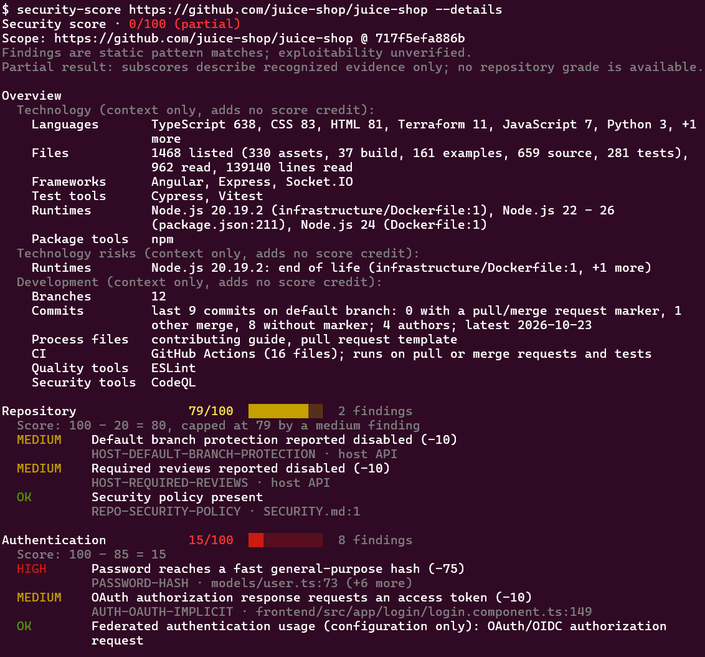

# Security Score

Scans a repository and gives it a security score from 0 to 100 and a grade
from A to F. It looks at source code, dependencies, CI, container and Terraform
files, and repository settings. For a change, such as a commit or staged files,
it rates the security relevance instead: `high`, `medium`, `low`, or `unclear`.

The checks are fixed rules, so the same input always gives the same result. No
LLM and no AppSec Analyzer are needed. The score is a quick indication: 100
means the checks found nothing, not that the code is secure.

## Quick start

Requires Python 3.10+, `pipx`, and Git with SSH access to GitHub.

```sh
pipx install "git+ssh://git@github.com/appsec-foundry/appsec-analyzer-tools.git#subdirectory=security-score"

security-score /path/to/repository             # score
security-score /path/to/repository --details   # overview, subscores and findings per topic
security-score /path/to/repository --details --checks authentication,tls,headers
security-score /path/to/repository --quiet     # only the number, without progress
security-score https://github.com/juice-shop/juice-shop
security-score /path/to/repository --staged    # relevance of staged changes
```

Without a path, the current directory is scanned. From a clone of this
repository, `pipx install ./security-score` works as well.

## Examples

Score of a local repository:

```console
$ security-score /path/to/repository
59/100 (E)
```

`59/100 (partial)` instead of a grade means that some checks were inconclusive
or a limit was reached. The number then covers only the recognized evidence.

With `--details`, the report starts with an overview of the repository, then
lists the score and findings per topic. This is the top of a scan of
[Juice Shop](https://github.com/juice-shop/juice-shop), an intentionally
insecure training application, so the low score is expected:



- `0/100 (partial)` is the overall result. Partial means that some topics
  could not be assessed, so there is no grade.
- *Overview* describes the repository. It is context only and adds no points.
- Each topic below it (here Repository and Authentication) has its own
  score. `Score: 100 - 85 = 15` shows how it came about. Each finding shows
  its rule ID, file, line and the points it deducted. `OK` lines are positive
  evidence and add no points.

The report continues in the same layout with Architecture, Frontend,
Dependencies & CI, Secrets, Cryptography and Deployment & transport, and ends
with a coverage line. Under Authentication it also lists the identity servers
and grants it recognized. Server origins omit credentials, paths and query
parameters. A closing line shows the scan time, for example `Duration: 8.42 s`;
JSON/YAML with `--details` includes `duration_seconds` instead.

Only the number, for scripts and CI. Always check the exit status as well;
here, `2` marks a partial result:

```console
$ security-score /path/to/repository --quiet; echo "exit $?"
59
exit 2
```

Security relevance of the last commit:

```console
$ security-score /path/to/repository --commit HEAD
Security relevance: high · 0 introduced, 0 worsened findings
```

With `--details`, the output lists the signals behind the rating by rule, with
file and line.

## Reading the score

Each area, such as execution or transport, starts at 100 points. A finding
deducts points and caps the area score by its severity; only the first three
findings of a rule deduct points. The lowest area score is the repository score,
so a strong area cannot offset a weak one.

| Severity | Deduction per finding | Area score at most |
| --- | ---: | ---: |
| Critical | 50 | 39 |
| High | 25 | 59 |
| Medium | 10 | 79 |
| Low | 3 | 89 |

One high finding gives 59 (E); two high findings in the same area give 50 (E);
three or more findings of one high rule give 25 (F).

| Score | 90–100 | 80–89 | 70–79 | 60–69 | 50–59 | 0–49 |
| --- | --- | --- | --- | --- | --- | --- |
| Grade | A | B | C | D | E | F |

[Security Score explained](<security score.md>) has worked examples and explains
`partial`, `undetermined`, and `incomplete`. The optional Analyzer engine has its
own [scoring policy](references/compatibility.md).

### Topics in `--details`

| Topic | Checks |
| --- | --- |
| Repository | Host settings such as branch protection, rulesets, and required reviews (URL scans only); security policy file |
| Authentication | JWT verification, password hashing and direct password comparisons, OAuth implicit/password grants and PKCE method, explicit SAML audience/time-check bypasses, cookie flags, credentialed CORS, Django/Flask settings; SSO usage and identity-server/grant profile |
| Architecture | Code execution, SQL injection, and unsafe deserialization patterns |
| Frontend | HTML output sinks, framework bypasses, Content Security Policy, and other security headers (positive evidence only) |
| Dependencies & CI | Package sources and indexes, missing lockfiles, exactly pinned Python requirements, lockfile sources and integrity, Maven, Gradle, Cargo and `pyproject.toml` sources, install scripts, committed binaries, Action, image, GitLab include and Terraform module pinning, CI permissions, script injection, privileged pull request checkouts, downloads in CI and container builds |
| Secrets | Credential and key files by name, Terraform state, and credentials in formats with a fixed prefix |
| Cryptography | Weak hashes and predictable random values |
| Deployment & transport | Debug mode, container host privileges, TLS verification including Python client contexts, TLS/certificate configuration evidence, and Terraform: open administrative ports, public storage and databases, wildcard IAM |

Each topic shows the lowest area score within it, how that score came about, and
up to three findings with file, line and points deducted. Below them, `OK` lines
show up to two kinds of positive evidence,
such as literal SQL text or pinned Actions, with a location and how often it
occurs. Positive evidence adds no points and does not offset findings. Some rules
can only report positive evidence, such as security headers, SBOM or provenance
steps, or a non-root container user. Their absence is no finding, and they cannot
make a topic or repository assessable.
SSO, TLS and certificate usage are also configuration evidence only. A package
name alone is not a successful check, and certificate validity or a live TLS
handshake is not tested. Header evidence includes CSP, HSTS, framing, content-type,
referrer and cross-origin opener/resource policies.
Architecture also shows a profile: SSO, passwords or both, the hash a password
reaches, authentication mechanisms, single-page app or server-side templates,
persistence, whether SQL queries are built by concatenation, deployment targets,
and whether CI logs in to a cloud through OIDC or a stored key. SSO counts when a
package, a setting or a provider's sign-in URL in the code shows it; whether it is
switched on stays open. Dependencies & CI shows a similar profile: lockfiles, how
many direct dependencies name an exact version, and Renovate or Dependabot. Both
profiles are context and add no points.
`--json` and `--yaml` contain every finding and the full calculation.

### Overview in `--details`

`--details` starts with an overview of the repository. Only this mode collects it:
a plain, `--json`, `--yaml` or `--quiet` scan does not load this code, reads no Git
history and sends no extra API request.

| Block | Content |
| --- | --- |
| Technology | Languages, files by kind, frameworks, test tools, declared runtimes, package tools |
| Technology risks | Entries of a bundled list: dependencies that are insecure in every version or end of life, such as `node-serialize` or Log4j 1; runtimes and base images past end of life; DES, RC4, ECB mode and TLS below 1.2; Flash and Silverlight content |
| Development | Branches, up to the last 100 commits with pull or merge request markers, merges, authors and latest date; CODEOWNERS and other process files; CI system, whether it runs on pull or merge requests and runs tests; quality and security tools |

The overview is context. It never changes the score, grade, findings or exit
status. That includes technology risks: they run only with `--details`, and a score
must not depend on the output mode. An empty row says nothing was recognized, not
that the technology is absent. Risk entries cover manifests, source and build files
outside `tests` and `examples`, and Go and Ruby manifests are not read.

Commits follow the first-parent line. A commit without a marker may still have been
reviewed, because a rebase or an unmarked squash merge leaves no trace in the
subject. Author addresses are counted, never shown. URL scans take one page of
commits from the host API, which also lists side branches, so often fewer than 100
remain. A directory without `.git` or a rate limit shows as `unavailable`.

### Exit status

| Status | Meaning |
| --- | --- |
| 0 | Complete result: a score with grade, or a finished change analysis (also `unclear`) |
| 1 | Incomplete result or error: a limit such as the time budget was reached, the repository was not accessible, or processing failed |
| 2 | Partial or undetermined result, or invalid arguments |
| 130 | Cancelled |

## Usage

### Repository URLs

HTTPS URLs on GitHub.com and GitLab.com are supported, including nested GitLab
groups. For SSH URLs and self-hosted servers, scan a local checkout. URLs must
not contain credentials, query strings, or fragments.

The tool does not clone the repository. It lists the files at one commit and
downloads only files it can check. If a large repository does not fit into the
60-second budget, the result is partial; `--timeout 120` allows a larger sample.

Private repositories need a read-only API token. Put it in an environment
variable and pass the variable name:

```sh
security-score https://github.com/example/private-project --token-env GITHUB_READ_TOKEN
```

A missing repository and a private one without access can both return HTTP 404,
so the error message cannot always tell them apart.

Without a token, GitHub allows 60 API requests per hour per IP address, shared
with everything else on that address. A scan uses three or four of them, because
files come from `raw.githubusercontent.com`, which does not count; `--details` adds
two for commits and branches. A token raises
the limit to 5,000 per hour. For a public repository it goes only to the API; file
downloads stay on the raw host without the token. A private repository uses one
API request per file. When a limit is reached, the error says how long to wait.
The tool never picks up a token on its own: `GITHUB_TOKEN` and `gh` logins are used
only if you name the variable with `--token-env`.

With `--details`, a closing `Network:` block reports HTTP request attempts and
download volume, in total and per host. This includes host settings, file
listings, selected files and the overview's commits and branches; failed HTTP
attempts count too. Local scans report zero HTTP requests. Measuring adds no
requests. JSON/YAML with details includes the same counters under `network`,
with exact byte counts in `response_body_bytes`.

The byte count measures response body bytes actually read, including partial or
oversized reads discarded by the scan. It excludes unread bodies (including
rejected HTTP error responses), HTTP headers, uploads, DNS and TLS/TCP overhead;
it is not total traffic on the network interface. A connection that fails before
an HTTP request can be attempted does not count as a request. These counters
cover the internal engine; the optional Analyzer engine is not instrumented.

### Changes

Choose one comparison per call:

```sh
security-score /path/to/repository --staged              # staged changes vs. HEAD
security-score /path/to/repository --unstaged            # working files vs. index
security-score /path/to/repository --worktree            # working files incl. untracked vs. HEAD
security-score /path/to/repository --commit abc1234      # commit vs. its parent
security-score /path/to/repository --base main --head HEAD
security-score /path/to/repository --patch changes.diff  # unified diff, also --diff
```

`--pr URL` or `--mr URL` attaches a GitHub PR or GitLab MR link to a local
comparison or patch; it does not download anything. The relevance levels are
explained in the [technical reference](references/scoring.md#change-relevance).

### Options

Choose checks without editing the bundled rules:

```sh
security-score --list-checks
security-score /path/to/repository --checks authentication,tls,headers --details
security-score /path/to/repository --skip-checks dependencies --details
security-score /path/to/repository --checks JS-JWT,PY-JWT --json
```

The default is `all`. Available groups are `authentication`, `tls`, `headers`,
`architecture`, `frontend`, `dependencies`, `secrets`, `cryptography`, `deployment`
and `repository`; individual rule IDs from `--list-rules` also work. Groups can
overlap. `--skip-checks` removes checks from the selection. Selection applies to
internal repository scans, and an empty or unknown selection is an argument error.
A subset reports its recognized index as partial and withholds the overall
repository grade; `--checks all` preserves the default behavior.

`--details` logs preparation, selected-check count, file progress, path checks,
profile collection and scoring steps to stderr. JSON/YAML and both spellings
`--quiet`/`--quite` suppress progress. Quiet mode prints only the numeric index;
the exit status still indicates partial coverage.

| Option | Meaning |
| --- | --- |
| `repository` | Local directory or supported HTTPS URL; defaults to the current directory. `--repo DIRECTORY` is an alternative for local directories. |
| `--details`, `--detail` | Repository overview, subscores and findings per topic; for changes, the signals grouped by rule. |
| `--quiet`, `--quite` | Print only the number, or nothing if there is none. Cannot be combined with `--json`, `--yaml`, change analysis, `--list-rules`, or `--verify-rules`. |
| `--json`, `--yaml` | Structured output with all findings and the calculation. With `--details` it also contains the `overview`. |
| `--token-env NAME` | Environment variable that holds the API token for a repository URL. |
| `--timeout SECONDS` | Time budget from 0.1 to 120 seconds; default 60. |
| `--engine analyzer` | Use a separately installed AppSec Analyzer instead of the bundled rules; repository scans only. `--analyzer PATH` sets the absolute path of a trusted executable; otherwise it is taken from `PATH`. See [compatibility](references/compatibility.md). |
| `--list-rules` | Show the bundled rules. |
| `--list-checks` | List selectable groups and their check counts without scanning. |
| `--checks GROUPS_OR_IDS` | Run comma-separated groups or rule IDs; default `all`. |
| `--skip-checks GROUPS_OR_IDS` | Omit groups or rule IDs from the selected checks. |
| `--verify-rules` | Run the bundled rule examples. |
| `--version` | Show the version and the Git commit it was built from. |
| `--update` | Update the pipx installation; see below. |

Text output is colored only on an interactive terminal. Set `NO_COLOR` to turn
color off.

## Update and reinstall

```sh
security-score --update
security-score --version
```

`--update` runs `pipx upgrade --pip-args="--upgrade --force-reinstall --no-cache-dir" appsec-security-score`.
It reinstalls from the source pipx recorded at installation: the default branch
of this repository or your local clone, not a signed release. Review changes
you do not trust before updating.

To repair a stale or broken installation:

```sh
pipx install --force --pip-args="--upgrade --force-reinstall --no-cache-dir" \
  "git+ssh://git@github.com/appsec-foundry/appsec-analyzer-tools.git#subdirectory=security-score"
```

From a clone, use `./security-score` instead of the URL.

## Limits

- The rules recognize static patterns. Findings are pattern matches, not confirmed
  vulnerabilities.
- Not checked: login flows, access control, business logic, and known
  vulnerabilities in dependencies.
- Secrets count only with a fixed prefix or a recognized file name; a generic
  key or password in source code is not found. Credential values never appear in
  the output, and sensitive files are not read.
- JavaScript/TypeScript password hashing follows direct calls and simple helpers,
  including one relative import to a named ESM export. Python helpers stay within
  one file. Re-exports, runtime aliases and complex data flows are not resolved;
  KDF parameters are not checked.
- Application code is read for Python and JavaScript/TypeScript only. A repository
  in another language gets configuration checks at most.
- Code, tests, and builds of the scanned project are never run.
- Time and size limits are listed in the
  [technical reference](references/scoring.md#limits).

## Development

Run from `security-score/`:

```sh
python3 -B -m unittest test_security_score test_security_controls -v  # offline tests
python3 -B -m unittest test_packaging -v        # build and install a wheel
python3 scripts/score.py --verify-rules         # rule examples
```

The packaging test needs `setuptools>=61`, `wheel`, and a pip with `--python`
support; it downloads no packages.

Before releasing changes to URL scanning or console output, run the live test
against Juice Shop. It takes about three minutes:

```sh
SECURITY_SCORE_LIVE_E2E=1 python3 -B -m unittest test_e2e_juice_shop -v
```

It builds and installs a wheel from the current checkout, scans
`https://github.com/juice-shop/juice-shop` in the default, `--details`, and
`--quiet` modes, and stores outputs, exit statuses, and hashes in
`out/juice-shop-e2e/`. Juice Shop code is not run. To test an existing
installation instead, also set `SECURITY_SCORE_E2E_EXECUTABLE` to the absolute
path of its `security-score`.

How to change rules and weights is described in the
[technical reference](references/scoring.md#maintaining-the-rules).
